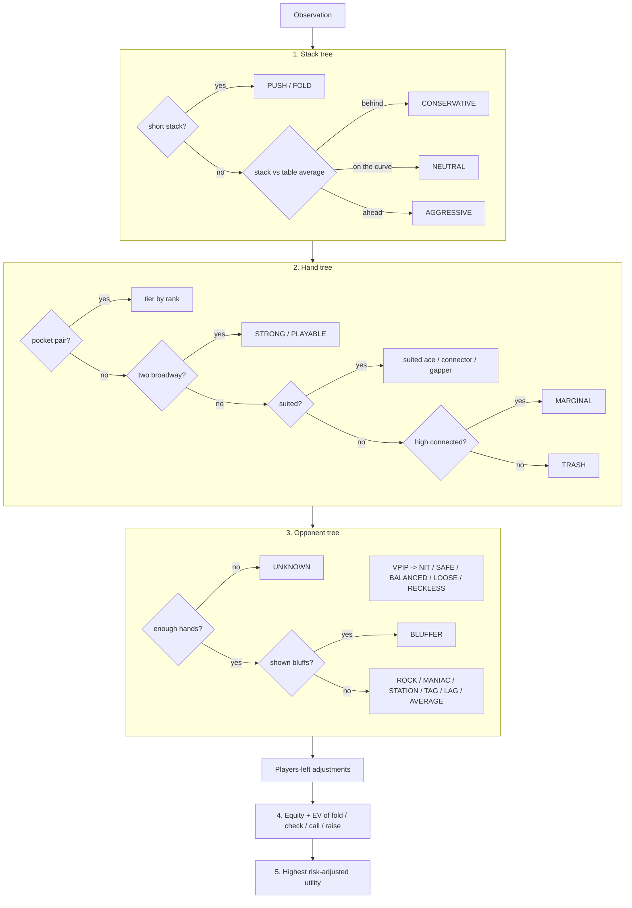

# No Limit Poker Bot: Model Overview

A bot built for **[No Limit](https://pokerbot.sequoiacap.com/)**, the student bot-building poker tournament run by Sequoia, OpenAI and Citadel Securities. This repository describes how the model works and how it scores in the competition's format. **The source code, trained thresholds and equity tables are private.**

It is an interpretable decision-tree model. Every decision comes with a written trace explaining each step, and the trees' thresholds are tuned by simulating the competition's scored tournaments.

## Competition format

From the [official rules](https://pokerbot.sequoiacap.com/rules.html), with section numbers:

| Rule | How the model handles it |
|---|---|
| **Scored tournament** = 10,000 eight-bot sit-and-gos (4.3); six tournaments T1–T6, weighted 1–6 (4.1, 4.7) | Results below come from simulating exactly that: 10,000 tables per tournament, scored as average points per table, plus the weighted T1–T6 score. |
| 2,000 chips, blinds start at 10/20 and rise every 25 hands; a table ends when one bot has every chip or after 200 hands (4.4) | Every decision is scaled to the current blinds. Stack depth is measured in big blinds and against the table average. |
| Points by finishing place; at the 200-hand cap, the remaining points go to survivors by **ICM** (4.5) | Training optimizes this exact score, including Malmuth–Harville ICM at the cap. |
| **1 ms per decision**; errors or timeouts fold, or check (3.7) | Equity comes from precomputed lookup tables, not live simulation. A typical decision takes about 0.05 ms. Any internal error falls back to check or fold. |
| Bot state resets each table; opponents are anonymized (3.8) | Opponent models are rebuilt from scratch at each table using only what is seen there. |
| Variant revealed at each build phase; **the Finals use a different variant** (3.2, 5.2) | The hand-ranking order can be swapped and the equity tables rebuilt in about a minute. Tested under pot-limit and flush-beats-full-house rules. |
| Python Agent interface; no network; 100 MB limit; one submission every 5 minutes (3.3–3.7) | Standard-library Python only. The whole bot (code, tables and thresholds) is one file of about 165 KB, checked end to end in a clean interpreter before upload. |
| Starter kit at the event: Agent template, local simulator, ICM calculator, payouts, blind schedule (3.3) | Points and later blind levels are placeholders until then. Retraining with the real ones takes about 10 minutes. |

## Scored-tournament results

Stage 9 bot. Each tournament is 10,000 simulated eight-bot sit-and-gos in the rules' format. Points use the placeholder table 100/60/40/25/15/10/5/0, where the field average is 31.9.

| Opponent field | T1 | T2 | T3 | T4 | T5 | T6 | **Weighted score** | Outright wins |
|---|---|---|---|---|---|---|---|---|
| Rehearsal sparring bots: TAG, LAG, short-stack, ICM, adaptive, heuristic, random | 47.0 | 46.9 | 47.3 | 47.3 | 47.1 | 47.7 | **47.3** | 16.1% |
| Archetype pool: rock, TAG, maniac, station, bluffer, push/fold, plus bot copies | 52.7 | 53.1 | 52.9 | 52.3 | 52.8 | 52.4 | **52.6** | 14.5% |
| Mixed | 49.5 | 50.2 | 50.5 | 49.9 | 50.2 | 50.1 | **50.1** | 15.3% |

The 95% CI for each tournament is about ±0.6 points. An average bot would score 31.9; first place every table would score 100.

Head-to-head checks in the same format, using [Poker Gym](https://github.com/mack-dot/poker-gym), an open-source rehearsal simulator of the No Limit rules:

| Check | Result |
|---|---|
| vs a tight-aggressive (TAG) reference bot in the same seats | **+10.2** points per table (95% CI +8.3 to +12.0) |
| 8-bot ladder, 400 tables | **1st**, 45.4 (next best: 38.0) |
| Heads-up endgames vs each reference bot | wins 60–63% |
| Decisions over 1 ms / errors / illegal actions | 1 in 283,227 (under heavy machine load) / 0 / 0 |

## Architecture



### 1. Stack tree

The bot compares its stack with the table average:
- **Behind the curve:** it plays conservatively, with tighter ranges, smaller bets and a penalty on chips at risk.
- **Ahead of the curve:** it plays aggressively, with wider ranges, bigger bets and more fold equity.
- **Short-stacked:** it switches to push/fold, shoving a top-X% range that widens as the stack shrinks, as fewer players are left to call, and against tight tables.

### 2. Hand tree

- **Preflop:** a tier from TRASH to PREMIUM, based on pairs, broadways, suitedness and connectedness.
- **Postflop:** a made-hand class plus draws.

Separately, every hand has an **equity-based percentile**: the 169 starting-hand classes are ordered by all-in equity against one random hand and against three random hands. All ranges ("top X%") are expressed on this scale.

### 3. Opponent tree (built during the game)

For each opponent the bot tracks:
- **Preflop:** VPIP and preflop raise rate, counted only over hands where it actually saw their decision.
- **Postflop:** aggression factor, fold-to-bet, and bluffs shown at showdown. A bet counts as a bluff when the hand was weaker than a random hand on the board *as it was when the bet was made*.
- **Bet sizing:** how often their postflop bets are big overbets. Real players almost never size like a random bot, so random-looking sizing counts as evidence that their bets carry no information, even when no cards are ever shown.

These stats drive:
- **Play safety:** NIT / SAFE / BALANCED / LOOSE / RECKLESS, from VPIP.
- **Style:** rock, TAG, LAG, maniac, bluffer or calling station.
- **Ranges:** a caller holds the top VPIP%, a preflop raiser the top PFR%, and the betting range of a proven bluffer (or a random sizer) widens toward any two cards.
- **Gate shifts:** the bot tightens against raises from safe players and loosens against loose ones. It steals more at tight tables and less at loose ones.
- **Confidence:** every stat is smoothed toward a population prior until enough hands are seen. The trace reports what share of each estimate is data and what share is prior.

### Short-handed play: playing to win

Finishing first is worth far more than second (100 vs 60 points), and first place is decided once only two or three players are left. As players bust:
- **Range gate:** besides the tier gate, it plays any hand inside a range that depends on how many players are still to act. A7o folds under the gun but raises heads-up.
- **Blind defense:** facing a raise, it continues more widely as the table shrinks, but only when the call is cheap. It never calls off its stack light.
- **Opponent ranges widen**, because their stats were gathered mostly at full tables. Once there's enough short-handed data, their recent hands replace that estimate.
- **Risk aversion falls to zero heads-up**, where points are linear in chips.
- **Chip leader:** when it covers everyone in the hand, it expects more folds.

### 4. EV analysis

```
EV(call)  = equity * (pot + call) - call
EV(check) = equity * pot
EV(raise) = FE * pot + (1 - FE) * (equity_when_called * pot_if_called - chips_added)
utility   = EV - λ * chips_added * (1 - equity)
```

- **Equity** is a table lookup by hand class, opponents' ranges and number of opponents, built from millions of simulated deals.
- **Preflop**, players still to act are weighted by how likely they are to continue.
- **Postflop**, facing a bet discounts our equity, more for raises and re-raises and less against bluffers. When an opponent calls our bet, the equity estimate assumes they hold the stronger part of their range.
- **Fold equity** combines each opponent's fold-to-bet rate, the bet size, our stack status and the opponent's style.
- **λ (risk aversion)** comes from the stack tree and shrinks as the table gets short-handed.

### 5. Decision

It takes the option with the highest risk-adjusted utility and clamps it to a legal action.

## Example decision trace

Heads-up, facing a raise with A7o. The hand tree alone would fold this, but with two players left the range gate keeps it:

```
[1] STACK TREE
    stack 39.5 BB vs table average 39.8 BB (ratio 0.99, M = 26.3)
    ON THE CURVE: play NEUTRAL / standard
    2 players left -> risk aversion -> 0.0 (fewer places left to protect)
[2] HAND TREE
    A7o: top 23.2% of starting hands
    pocket pair? no / two broadway cards? no / suited? no / connected? no
    -> TRASH: unsuited, unconnected, low
[3] OPPONENT TREE
    2 players left -> opponent ranges widened (stats come mostly from fuller tables)
    villain1 (aggressor): UNKNOWN, plays SAFE -> modeled range top 34%
        voluntarily played 0 of 0 hands seen -> SAFE (0% data / 100% prior)
    preflop gate: tier gate says fold; hand is top 23%, inside the heads-up
                  defend range -> play anyway
[4] EV ANALYSIS
    equity 47.9% vs 1 likely opponent (table lookup)
    pot 500, to call 300: pot odds 37.5% -> calling is +EV
    fold          EV     +0.0
    call     300  EV    +83.1 (+0.4 BB)
    raise   1000  EV   +233.3 (+1.2 BB)  fold equity 57%, equity when called 42%
[5] DECISION
    RAISE to 1000 - highest risk-adjusted utility
```

## Training

The thresholds (50 of them) are tuned by an evolution strategy that plays complete tournaments.

**Fitness:** the No Limit score itself, average points per 8-bot sit-and-go, with finishing-place points and ICM at the 200-hand cap.

**Environments**, alternated by table:
1. My own tournament engine, with rule-based archetypes (rock, TAG, maniac, calling station, bluffer, push/fold) plus copies of the bot.
2. Full rehearsal-simulator (Poker Gym) tables against its sparring bots (TAG, LAG, short-stacker, ICM-aware, adaptive), plus heuristic and random bots standing in for naive entries.
3. An **endgame** environment with only 2–3 players left, which is the phase that decides first place.

**Search:** each generation, mutations of the current best are played on the same fresh tables (common random numbers). A candidate must beat the incumbent by more than 1.5 standard errors and then win again on a second fresh batch before it's accepted. Wide random restarts help it escape local optima.

**Validation:** results are always checked on held-out tables never used in training.

## Development history

| Stage | Change | Points per table vs sparring bots (2,000 tables) | vs TAG baseline |
|---|---|---|---|
| 1–3 | Core trees, VPIP / play-safety, position; trained on own engine | – | – |
| 4–5 | Rehearsal simulator (Poker Gym) added as a training environment; preflop EV and postflop aggression fixes | 31.1 | −1.8 |
| 6–7 | **Playing to win:** short-handed range gate, heads-up fixes, endgame training | 40.9 | +8.0 |
| 8 | Equity-based hand ranking (replacing the lumpy Chen-formula order) | 43.5 | +10.6 |
| 9 | Heuristic and random bots added to the training field | 43.1 | +10.2 |
| 9.1 | **Random-sizing read:** overbet-heavy bettors treated as uninformative | 43.1 | +10.2 |

The stage 6–7 diagnosis: the bot often finished second but rarely first. Heads-up it kept only about 25% of the chips against every reference bot, because it folded about 77% of hands preflop and stayed risk-averse when only chips were at stake. After the fixes it wins 60–63% of heads-up matches.

Stage 9.1 targets the last heads-up weak spot, a purely random bot. A random bot picks its raise size uniformly up to all-in, so about 75% of its postflop bets are huge overbets; every reference bot that plays for real does that in about 2% of bets or fewer. Reading that gap fixes most of the leak without needing to see any showdown cards (1,000 heads-up matches each):

| Heads-up opponent | Before | After |
|---|---|---|
| Random bot: share of chips at the end | 53% | **67%** |
| Random bot: matches won | 53% | **67%** |
| TAG, LAG, ICM, adaptive, heuristic, short-stack | 71–89% | unchanged (the read never triggers) |

A paired A/B on 3,000 held-out tables in each training environment shows no change anywhere else (all within ±0.25 points). Decisions still take at most 0.15 ms.

## Robustness

Each row is 1,000–2,000 tables in the rehearsal simulator, with paired seats against the TAG baseline:

| Field / rules | Points per table | vs TAG |
|---|---|---|
| sparring (training lineup) | 43.1 | +10.2 |
| mixed (adds heuristic + random) | **47.0** (was 45.8) | **+10.3** (was +9.6) |
| 7× TAG | 44.3 | +11.9 |
| 7× LAG | 47.0 | +9.3 |
| weak field (call / random / heuristic) | 71.6 | +3.7 |
| one jam-every-hand bot | 49.2 | +13.8 |
| two raise-with-anything bots | 54.5 | +7.3 |
| pot-limit variant | 43.2 | +10.6 |
| flush-beats-full-house variant | 43.2 | +9.8 |

## Known limitations

- **Random bots:** heads-up against a purely random bot it now keeps about 67% of the chips (up from 53%; a TAG bot keeps 72%). The remaining gap is the first dozen or so hands, before the sizing read has enough bets to go on. In a real sit-and-go the bot reaches heads-up with about a hundred hands of history.
- **Placeholder rules:** the real points table, later blind levels and poker variant are announced at the build phase, and the Finals variant differs again (5.2). The model is retrained with them on the day, which takes about 10 minutes.
- **Monte Carlo refinement:** live simulation on top of the tables was tried and dropped. The gain was within noise, and some decisions went over the 1 ms limit.

---

Not affiliated with Sequoia, OpenAI, Citadel Securities or Poker Gym. Format details come from the public rules page. The bot's code is in a private repository. This overview is updated whenever the model changes.

*Last updated: 2026-11-11 (stage 9.1: random-sizing read).*
